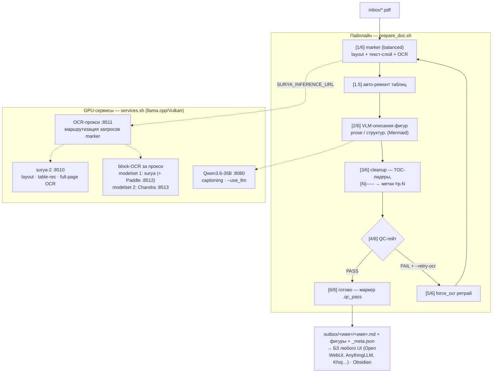

# docpreparation — преп-пайплайн PDF → Markdown для базы знаний

Локальный конвейер подготовки документов: **PDF → готовый `.md`** (текст,
таблицы, VLM-описания графики, метки страниц) с QC-гейтом качества.
Целевые потребители — **любой UI с локальной базой знаний** (Open WebUI,
AnythingLLM, Khoj…) и Obsidian: пайплайн от UI не зависит, на выходе —
готовый к индексации Markdown. Всё считается на локальном железе
(Strix Halo / Radeon 8060S, llama.cpp/Vulkan), без облака.

> Главный справочник по возможностям, примерам, замерам и реестру требований —
> [docs/USAGE.md](docs/USAGE.md). Статус/планы — [docs/HANDOFF.md](docs/HANDOFF.md).

## Зачем

Встроенные конвертеры UI с базами знаний тихо теряют текст на русскоязычных
PDF: шрифты без ToUnicode дают 0% кириллицы в индексе при «успешной» загрузке,
таблицы склеиваются в мусор, оглавления с точечными лидерами попадают в чанки,
нет layout-анализа и привязки к страницам (аудит двух БЗ —
[docs/COMPARISON.md](docs/COMPARISON.md)).

Вывод: **PDF не должен быть рабочим форматом входа в БЗ** — конвертация
делается заранее, вне UI, с контролем качества. Готовый `.md` индексируется
чисто.

## Возможности

- **Конвертация с сохранением контента** — marker + surya-2: layout, таблицы
  (текст-слой → table-OCR → фолбэк), полнотраничный OCR сканов и битых шрифтов.
- **QC-гейт** (`qc_check.py`) — доля целевого алфавита ≥55% среди букв,
  TOC-лидеры, переносы, таблицы, сырой HTML; язык ru/en: флаг > env > авто-детект.
  «Мусорный, но непустой» текст = FAIL, а не успех.
- **VLM-описания фигур** (`caption_figures.py`) — локальная 35B быстрее облака
  (5,4 с/фигура); структурный режим: Mermaid-диаграммы (валидация mmdc),
  таблицы значений, связи сущностей — графика становится находимой в RAG.
- **Метки страниц** `⌗p.N` — привязка «чанк БЗ → страница исходника»: метка
  переживает чанкинг, грепается (`grep -n '⌗p\.42' *.md`).
- **Авто-ремонт таблиц** (`table_repair.py`) — «Table OCR failed» в логе marker →
  fast-ретрай страницы → вставка в конец секции; сложные случаи — VLM-реконструкция.
- **Фрагментация + автосклейка** (`--fragments K`, `merge_fragments.py`) —
  огромные книги кусками; resume с места обрыва, посимвольная проверка
  вхождения частей, объединение `_meta.json`.
- **Гибридный OCR-стек** (`ocr_proxy.py`) — OpenAI-совместимый прокси за алиасом
  surya: layout/table-rec = surya, block-OCR = выбранный движок (modelset);
  A/B-сравнение движков (`ab_block_ocr.py`).
- **Batch-обвязка** (`launch_batch.sh` / `prepare_all.sh`) — авто-диспетчер по
  типу inbox, resume (`.qc_pass`), ETA по медиане таймингов, факт-скорость по
  `/stats` прокси, сводная таблица PASS/FAIL, паузы на охлаждение.
- **Вэб-путь** (`prepare_web.sh`) — MD из Obsidian Web Clipper → тот же
  captioning + cleanup + QC.

## Архитектура



Стадии пайплайна последовательны (`[1]–[6]`); GPU-сервисы вызываются стадиями
`[1]` (через прокси) и `[2]` (напрямую). Обратный канал качества: метки `⌗p.N` —
из ответа БЗ открыть исходную страницу PDF; авто-ремонт опирается на них как на
границы секций.

## Быстрый старт

```bash
cp .env.example .env          # пути к GGUF-моделям (+ опц. облако captioning)
uv sync                       # .venv (marker-pdf), глобальный Python не трогается
./services.sh start           # modelset 1 (деф.): surya :8510 + Paddle :8512
                              # + прокси :8511 + Qwen :8080 (прокси — по умолчанию)
./services.sh start --modelset 2   # modelset 2: surya + Chandra :8513 + прокси + Qwen

cp файл(ы).pdf inbox/
scripts/launch_batch.sh       # пакет: видимое окно, логи logs/batch_latest.*
./services.sh stop
# результат: outbox/<имя>/<имя>.md — готов к загрузке в БЗ
# (UI с локальной базой знаний: Open WebUI, AnythingLLM, Khoj…)
```

Примеры вызовов (полный набор — USAGE §2.0–2.2):

```bash
scripts/launch_batch.sh                    # всё, что в inbox/
scripts/launch_batch.sh --pages "1-10"     # проба: первые 10 стр. каждого файла
scripts/launch_batch.sh --fragments 4 --fragment-pause 120   # большой файл кусками
scripts/launch_batch.sh --force --retry-ocr --lang en       # перегон + OCR-ретрай
scripts/prepare_doc.sh --pages "5-20" <pdf> # один файл, диапазон
CAPTION_STRUCTURED=1 scripts/launch_batch.sh  # структур. VLM-описания (Mermaid)
```

## Компоненты

| Компонент | Роль |
| --- | --- |
| [marker-pdf](https://github.com/datalab-to/marker) 2.x (Apache-2.0) | ядро конвертации: layout, таблицы, пагинация (`paginate_output` → `⌗p`) |
| [surya-2](https://github.com/datalab-to/surya) (GGUF, OpenRAIL-M) | OCR/layout VLM; локально: `models/surya-ocr-2-gguf/` |
| [Chandra OCR 2](https://github.com/datalab-to/chandra) (GGUF Q8_0) | block-OCR за прокси (modelset 2): layout-HTML с таблицами/Mermaid/alt |
| PaddleOCR-VL-1.6 (GGUF) | block-OCR за прокси (modelset 1; `OCR_PROXY_BLOCK_ENGINE=paddle`) |
| Qwen3.6-35B-A3B (GGUF Q6, mmproj-F32) | captioning/VLM-описания; p=2 (5,4 с/фигура) |
| [llama.cpp](https://github.com/ggml-org/llama.cpp) (Vulkan) | inference-серверы: surya `:8510`, Paddle `:8512`, Chandra `:8513`, Qwen `:8080` |
| poppler (`pdfinfo`, `pdftoppm`, `pdftotext`) | метаданные, рендеры, текст-слой |
| node + mmdc (Mermaid CLI) | валидация Mermaid в структур. режиме captioning |
| uv | изолированное окружение проекта (`.venv`, `uv.lock`) |
| opencode + skill `.opencode/skills/docprep/` | агент ведёт пайплайн (версионируется в репо) |

### Веса моделей

Все GGUF по умолчанию ищутся в `models/` **в корне репо** (каталог в
`.gitignore`) — скопируй/скачай веса туда, и `services.sh start` заработает
без конфигурации:

```text
models/
├── surya-ocr-2-gguf/          # surya-2.gguf + surya-2-mmproj.gguf
├── PaddleOCR-VL-1.6/          # PaddleOCR-VL-1.6-GGUF.gguf + …-GGUF-mmproj.gguf
├── chandra-ocr-2-gguf/        # scripts/download_chandra_gguf.sh (sha256 из HF API)
└── Qwen3.6-35B-A3B-MTP-GGUF/  # любая GGUF-модель LLM/VLM + mmproj для captioning
```

Другое расположение (общий каталог моделей на другой диск) — пути
`*_MODEL`/`*_MMPROJ` в `.env` (шаблон — `.env.example`). Отсутствие весов
ловится на старте с понятной ошибкой.

### Наборы моделей (`services.sh --modelset N`, деф. 1; детали — USAGE §2.1, §3.7)

| modelset | Состав | Когда |
| --- | --- | --- |
| **1** | surya + Paddle + прокси-pass-through + Qwen | деф.; проверенный стек (`--no-ocr-proxy` — отключить прокси) |
| **2** | surya (layout/table) + Chandra `:8513` (block-OCR) + Qwen | точечно (не дефолт): сложные таблицы в сканах/битых шрифтах, IDEF1X/ER, битый текст-слой; точнее surya, но на таблице-плотных доках block-OCR ~8× медленнее (когда включать — USAGE §3.7) |

## Тестовое окружение

| Компонент | Значение |
| --- | --- |
| APU | AMD Ryzen AI Max+ 395 (16 ядер / 32 потока, Zen 5) с Radeon 8060S — Strix Halo, gfx1151 |
| Память | 128 ГБ единая (UMA): 64 ГБ выделено под VRAM + 62 ГБ системной (GTT 112 ГБ) |
| ОС | Ubuntu 24.04.5 LTS (ядро 7.0.0-38-generic) |
| Inference | llama.cpp (Vulkan; тестировалось на b11734 = v0.7.0). Системный ROCm не нужен; **vLLM/ROCm на gfx1151 неприменимы** |

## Требования к памяти

Ориентировочно: веса GGUF (см. «Веса моделей») + KV-кэш + Python-стек пайплайна.
Компоненты — узлы диаграммы архитектуры выше; env — переменные `.env`
(шаблон — `.env.example`, применяются при `services.sh start` / на каждом
прогоне пайплайна).

| Конфигурация | Компоненты архитектуры | env / флаги | Грузится в GPU | RAM/VRAM |
| --- | --- | --- | --- | --- |
| modelset 1 полный (деф.) | `SURYA :8510` + `PROXY :8511` + `BLOCK → Paddle :8512` + `LLM :8080` | `MODELSET=1` (деф.) | surya 1,4 ГБ + Paddle 1,7 ГБ + Qwen3.6-35B Q6 32,7 ГБ | **~40 ГБ** единой памяти |
| modelset 2 полный | `SURYA` + `PROXY` + `BLOCK → Chandra :8513` + `LLM` | `MODELSET=2` | surya + Chandra Q8 5,3 ГБ + Qwen3.6-35B | **~42 ГБ** единой памяти |
| Только OCR (captioning пропускается) | `SURYA` + `PROXY` + `BLOCK → Paddle`; узел `LLM` не поднимается, стадия `[2/6]` скипается | `./services.sh start --no-llm` | surya + Paddle + KV | **~4–5 ГБ** — достаточно 8 ГБ VRAM |
| OCR локально + облачный LLM | `SURYA`/`PROXY`/`BLOCK` локально; `LLM :8080` не поднимается — стадия `[2/6]` идёт во внешний OpenAI-совместимый API | `CAPTION_API` (URL шлюза) + `CAPTION_MODEL` + `CAPTION_PARALLEL`; ключ — `LLM_API_KEY` | surya (+ Paddle) + KV | **~4–5 ГБ** + стабильный интернет |

- На дискретных GPU (раздельная память) полный modelset требует VRAM ≥ ~36 ГБ
  под 35B-модель — либо задать меньшую `LLM_MODEL` (узел `LLM`; требования
  падают пропорционально размеру модели), либо облачный captioning.
- Облачный captioning: любой OpenAI-совместимый шлюз (замер на Cherry-шлюзе:
  локальная 35B быстрее — 5,4 с/фигура против ~16–19 с в облаке; USAGE §2.4,
  §3.1) — облако нужно для слабого железа.

## Ограничения и особенности

- marker умеет спавнить свой llama-server на случайном порту, если `:8510` занят/
  недоступен (сирота ест VRAM) — поднимай сервисы через `services.sh` до запуска.
- Загрузка готового `.md` в БЗ — вручную через UI выбранного приложения
  (открытого API добавления материалов у большинства нет); после загрузки
  проверить реальными поисковыми запросами.
- Смена набора сервисов (`--modelset`, `--no-ocr-proxy`, `--surya-*`) — только
  через явный `./services.sh stop` → `start` (restart с `--no-llm` не трогает surya).

## Документация

| Документ | Что внутри |
|---|---|
| [docs/USAGE.md](docs/USAGE.md) | главный справочник: сценарии, все флаги, замеры, реестр требований |
| [docs/HANDOFF.md](docs/HANDOFF.md) | статус, открытые вопросы, следующие шаги, грабли |
| [docs/COMPARISON.md](docs/COMPARISON.md) | обзор OCR-моделей для Strix Halo (наши тесты GLM-OCR/PaddleOCR-VL/Chandra, modelset 1 vs 2) + сравнение с Docling/DeepDoc, аудит БЗ |
