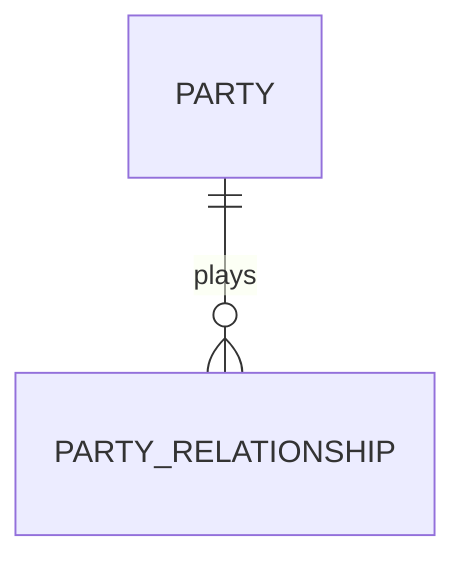

# План: структурированные VLM-описания (MD-таблицы / Mermaid)

> Принято 2026-10-17. Обсуждение — сессия анализа logs за 17.10.2026.
> Связанные доки: `docs/HANDOFF.md` (открытые вопросы), `docs/USAGE.md` (§2.4 captioning).

## 1. Цель и обоснование

Cherry Studio не индексирует картинки — графика находима в RAG только текстом.
Сейчас VLM даёт prose-описание (связный текст). Структурированное представление
(таблица MD / код Mermaid) дополнительно сохраняет **структуру** (узлы, связи,
ячейки), которую LMM-ранжировщик и генерирующая модель читают как данные.
Mermaid в чанке — это по сути сериализованный граф: сущности и связи доступны
и поиску, и модели при генерации ответа.

## 2. Зафиксированные решения

| Вопрос | Решение | Обоснование |
|---|---|---|
| Текущее prose-описание | **Остаётся всегда** | Страховка при невалидном Mermaid, обрезке чанкингом, лучше «человеческая» индексируемость |
| Синтаксис диаграмм | **Mermaid primary** | Лучший LLM-генерация (максимум тренировочных данных), нативный рендер: Obsidian, GitHub, чат Cherry Studio |
| Альтернатива | **Graphviz DOT** — через этап 2 (§6.5), триггер: >20–30% ошибок Mermaid после ретрая | DOT зрелее (грамматика, валидация `dot -Tsvg` без браузера), но рендер в стеке пользователя не нативный |
| PlantUML / D2 | **Не берём** | PlantUML: нужна Java; D2: мало данных у LLM → ошибки |
| VLM-таблицы в MD | **Только точечный ремонт** уже найденных дыр (потерянные таблицы marker), НЕ основной путь | surya table-OCR точнее на числах; VLM склонен к галлюцинациям в плотных таблицах |
| Вкл/выкл | Флаг `CAPTION_STRUCTURED` (деф. выкл) | Токены/время ×2–3 на фигуру — не для черновых прогонов |

## 3. Формат вставки в MD

````markdown

> **VLM-description:** ER-model of Level 2 Party pattern… (prose, 1–2 строки)



Связи:
- PARTY → PARTY_RELATIONSHIP (one-to-many, «plays»)
````

Правила:
- Mermaid-блок **< ~40 строк** — иначе чанкинг CS разрежет диаграмму.
- **Текстовый список связей рядом с Mermaid** («Связи: A → B при усл. X») —
  обязателен: ретривер/ранкер ищут по фразам, не по синтаксису; это главный
  RAG-выигрыш структуры (аддендум по внешней экспертизе 2026-10-17).
- **Неопределённости фиксируются явно**, угадывать нельзя:
  «связь B–C видна, направление не удалось определить». Пунктирную стрелку как
  «приблизительную» НЕ рисовать — в исходной нотации пунктир может иметь свой
  смысл. Выдуманная связь = ошибка хуже пропуска.
- Плотные диаграммы (50+ узлов): не Mermaid, а prose + список ключевых сущностей.
- Таблица-реконструкция помечается: `*VLM-реконструкция, сверить с PDF стр. N*`.
- Промпт: все label в кавычках (кириллица/скобки ломают парсер Mermaid).

## 4. Этап 0 — пилот без правки кода (½ дня)

`CAPTION_PROMPT` в `.env` с ветвлением по типу фигуры:
таблица → pipe-MD; схема → Mermaid в ```mermaid; иначе → prose.

Выборка:
- Vol.3 (Silverston) стр. 77, 92, 166 — векторные ER-диаграммы (рендеры `pdftoppm -r 150`);
- Vol.2 стр. 285–286 — таблицы (те же страницы, что в открытых вопросах HANDOFF).

Критерии успеха:
- ≥70–80% сгенерированных Mermaid валидны (проверка `npx -y @mermaid-cli -i x.mmd -o x.svg`, Chromium уже стоит);
- узлы/связи соответствуют оригиналу при сверке глазами:
  **выдуманные связи/узлы = фейл**; пропуски деталей — допустимо;
  **зафиксированные неопределённости** («направление не определено») = ок;
- таблицы: расхождение чисел ≈ 0 (выборочно против PDF).

Если Mermaid-ошибки >20–30% после ретрая → включается этап 2 (JSON-промежутка,
§6.5), который даёт и DOT, и текстовые списки из одного извлечения.

## 5. Этап 1 — реализация в `caption_figures.py`

1. Классификация типа фигуры (первый VLM-вызов коротким промптом, либо
   ветвление в одном вызове — решить по пилоту).
2. Ветвление промптов: таблица / диаграмма / прочее.
3. Для Mermaid: валидация mmdc → при ошибке ретрай ×1 **с текстом ошибки в
   промпте** → fallback на prose-only.
4. Few-shot пример erDiagram в промпте (строгий синтаксис кардинальностей `||--o{`).
5. Флаг `CAPTION_STRUCTURED=1` (деф. 0), логирование статистики
   (валидных/ретрай/fallback) в отчёт captioning.
6. Правила таблиц-реконструкций: объединённые ячейки (rowspan/colspan) →
   HTML-фолбэк (MD объединения не умеет); различать пустую ячейку / ноль /
   тире (не молча нормализовать); сохранять единицы измерения и примечания.
7. QC не трогаем — Mermaid/таблицы не влияют на существующие гейты.

## 6. Риски и меры

| Риск | Мера |
|---|---|
| Невалидный Mermaid (скобки, кириллица) | Промпт «label в кавычках», mmdc-валидация, ретрай с ошибкой, fallback prose |
| Галлюцинация чисел в таблицах | Только ремонт дыр + пометка «сверить с PDF» + запрет «додумывать» в промпте |
| Разрезание диаграммы чанкингом | Лимит ~40 строк, плотные схемы → prose |
| Рост времени/токенов | Флаг деф. выкл; структура только на фигурах-схемах/таблицах |

## 6.5. Этап 2 (условный) — JSON-граф + сериализатор

Триггер: на пилоте/этапе 1 прямой Mermaid-путь даёт >20–30% ошибок после ретрая.

Вместо «VLM сразу пишет Mermaid»:
1. VLM выдаёт **промежуточный JSON-граф** (nodes/edges с label, направлением,
   типом линии; поле `uncertainties`; источник — страница/файл). Схема —
   jsonschema; llama-server умеет `json_schema`, парсинг JSON-ответов в
   `ocr_proxy.py` уже отработан.
2. **Детерминированный сериализатор** JSON → Mermaid (и при необходимости DOT,
   и текстовый список связей) — экранирование спецсимволов и id больше не
   зависят от VLM.
3. Валидация структуры на JSON-уровне: висячие рёбра, дубли id, ссылки на
   несуществующие узлы — до генерации DSL.

Выгоды: одна выжимка → несколько представлений (Mermaid + DOT + список связей),
проверка структуры независимо от синтаксиса, локальные правки без повторного
VLM-вызова. Цена: +1 стадия и код сериализатора — поэтому этап условный, не
базовый.

## 7. Порядок работ

1. **Сначала** закрыть критичные потери из `docs/HANDOFF.md`
   (Vol.2 стр. 269/285/286; 4 таблицы) — структурированные описания
   не чинят уже потерянный контент.
2. Пилот (этап 0) — попутно закрывает вопрос «достаточно ли prose для Vol.3».
3. Реализация (этап 1) — после успешного пилота.
4. Этап 2 (JSON-граф + сериализатор) — только по триггеру из §4/§6.5.
